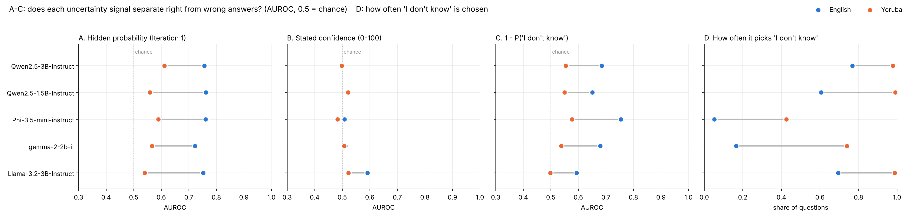
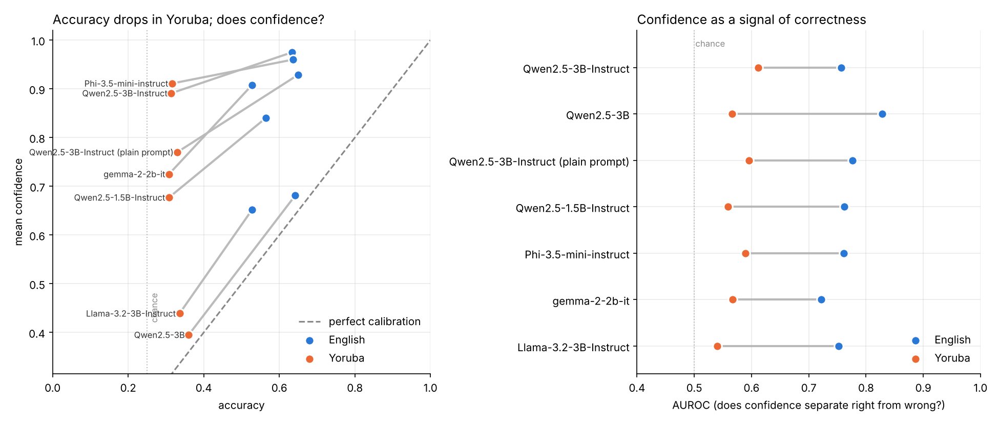
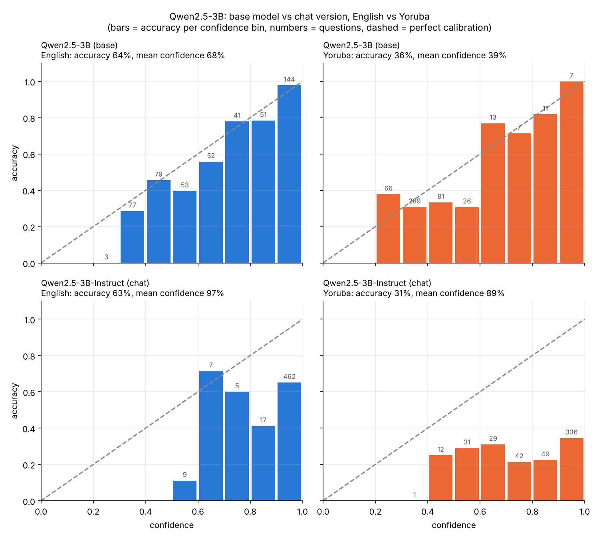
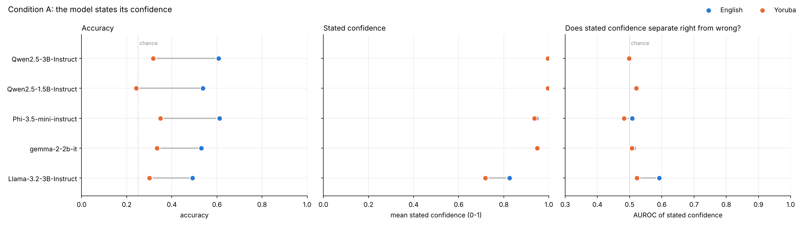
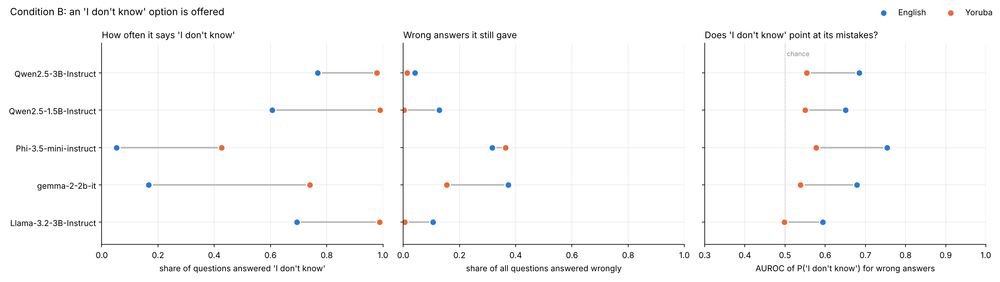

# Do language models know when they don't know — in Yoruba?

A small empirical study of **uncertainty in a low-resource language**. I take 500 multiple-choice
questions that exist in both English and Yoruba, and ask: when a model gets a Yoruba question wrong,
does anything in its behaviour show that it is unsure?

I test three signals a model (or a system built on it) could use to say "I'm not sure":

1. **Hidden confidence**: the probability the model puts on the answer it picks.
2. **Stated confidence**: the model writes its own confidence from 0 to 100.
3. **An "I don't know" option**: a fifth answer the model can choose instead of guessing.



## Main findings

- **In Yoruba, none of the three signals tells right answers from wrong ones.**
  Across five small chat models, the AUROC of every signal is 0.48–0.61 in Yoruba (0.5 = chance).
  In English, hidden confidence reaches 0.72–0.76. Accuracy itself falls from 53–64% to 31–34%,
  still above the 25% chance level.
- **Stated confidence carries no information in either language.** The models write almost the same
  number every time (Qwen: "100" for nearly every question; Gemma: "95" for 97% of them), so its
  AUROC is about 0.5 in English too.
- **Offered "I don't know", models refuse almost everything in Yoruba, without regard to which questions they would get
  wrong.** The "I don't know" rate rises by 21–57 points in Yoruba (43–99% of questions), but in
  Yoruba this choice is barely linked to which answers are actually wrong (AUROC 0.50–0.58). The
  model is reacting to the language, not to what it knows.
- **Chat tuning can hide the drop in confidence.** The base model Qwen2.5-3B lowers its confidence
  in Yoruba in line with its accuracy (39% confidence at 36% accuracy). Its chat version stays at
  89% confidence at 31% accuracy. A control with the same plain prompt confirms that the training,
  not the prompt format, causes most of this. This pattern also appears in Phi-3.5, but **not** in
  Gemma-2 or Llama-3.2, so it is model-specific.

**Why this matters for safety.** A model that cannot signal when it has misunderstood a question
will give confident wrong answers to speakers of low-resource languages, and safety checks that
rely on the model's own uncertainty (abstaining, deferring to a human, flagging low confidence)
will not trigger. This mirrors recent red-teaming work on Yoruba, where low harm rates turned out
to reflect poor comprehension rather than real safety ([Anyanwu et al., 2026](https://arxiv.org/abs/2610.39590)).

## Setup

| | |
|---|---|
| **Data** | [AfriMMLU](https://huggingface.co/datasets/masakhane/afrimmlu) test set (part of IrokoBench), English and Yoruba. 500 questions per language, 5 subjects × 100. Row *i* in Yoruba is the translation of row *i* in English, so every comparison is **paired** question by question. |
| **Models** | Qwen2.5-3B-Instruct, Qwen2.5-3B (base), Qwen2.5-1.5B-Instruct, Phi-3.5-mini-instruct, Gemma-2-2B-it, Llama-3.2-3B-Instruct. All run on one free Colab T4 GPU. |
| **Prompts** | The instruction is always in English; only the question and options change language. Greedy decoding, zero-shot. |
| **Hidden confidence** | Probability of each letter A–D as the next token, renormalised over the four letters. I check that the model actually puts its probability on the letters (mean letter mass ≥ 0.98 for every run). |
| **Metrics** | Accuracy; mean confidence; overconfidence (= mean confidence − accuracy); ECE (expected calibration error); **AUROC** (how well a signal separates right from wrong answers; 0.5 = chance). Yoruba-minus-English gaps use a paired bootstrap (2,000 resamples) for 95% confidence intervals. |

## Results

### Iteration 1: hidden confidence



| Model | Accuracy eng → yor | Confidence eng → yor | AUROC eng → yor | AUROC gap [95% CI] |
|---|---|---|---|---|
| Qwen2.5-3B-Instruct | 0.63 → 0.31 | 0.98 → 0.89 | 0.76 → 0.61 | −0.15 [−0.22, −0.08] |
| Qwen2.5-3B (base) | 0.64 → 0.36 | 0.68 → 0.40 | 0.83 → 0.57 | −0.26 [−0.32, −0.20] |
| Qwen2.5-3B-Instruct, plain prompt | 0.65 → 0.33 | 0.93 → 0.77 | 0.78 → 0.60 | −0.18 [−0.25, −0.11] |
| Qwen2.5-1.5B-Instruct | 0.56 → 0.31 | 0.84 → 0.68 | 0.76 → 0.56 | −0.20 [−0.27, −0.14] |
| Phi-3.5-mini-instruct | 0.64 → 0.32 | 0.96 → 0.91 | 0.76 → 0.59 | −0.17 [−0.24, −0.11] |
| Gemma-2-2B-it | 0.53 → 0.31 | 0.91 → 0.73 | 0.72 → 0.57 | −0.16 [−0.22, −0.09] |
| Llama-3.2-3B-Instruct | 0.53 → 0.34 | 0.65 → 0.44 | 0.75 → 0.54 | −0.21 [−0.28, −0.14] |

Every AUROC gap is negative and its interval excludes zero. For Qwen2.5-3B-Instruct and Phi-3.5,
confidence on a question in English has no relation to confidence on the same question in Yoruba
(correlation ≈ 0), so their Yoruba confidence does not reflect how hard the question really is.

**Base vs chat model.** Overconfidence (mean confidence − accuracy):

| Model | English | Yoruba | Yoruba − English [95% CI] |
|---|---|---|---|
| Qwen2.5-3B (base) | 0.04 | 0.04 | −0.01 [−0.06, +0.05] |
| Qwen2.5-3B-Instruct | 0.34 | 0.58 | **+0.24** [+0.18, +0.29] |
| Qwen2.5-3B-Instruct, plain prompt | 0.28 | 0.44 | **+0.16** [+0.11, +0.22] |
| Phi-3.5-mini-instruct | 0.32 | 0.60 | **+0.27** [+0.22, +0.32] |
| Qwen2.5-1.5B-Instruct | 0.28 | 0.37 | **+0.09** [+0.04, +0.15] |
| Gemma-2-2B-it | 0.38 | 0.42 | +0.04 [−0.02, +0.10] |
| Llama-3.2-3B-Instruct | 0.12 | 0.10 | −0.02 [−0.07, +0.03] |



### Iteration 2: asking the model directly

**A. Stated confidence.** The model must reply `Answer: <letter>` / `Confidence: <0-100>`.



| Model | Stated confidence eng → yor | Most common value in Yoruba | AUROC eng → yor |
|---|---|---|---|
| Qwen2.5-3B-Instruct | 0.99 → 1.00 | 100 (100% of replies) | 0.50 → 0.50 |
| Qwen2.5-1.5B-Instruct | 1.00 → 1.00 | 100 (96%) | 0.52 → 0.52 |
| Phi-3.5-mini-instruct | 0.94 → 0.94 | 95 (55%) | 0.51 → 0.48 |
| Gemma-2-2B-it | 0.95 → 0.95 | 95 (97%) | 0.51 → 0.51 |
| Llama-3.2-3B-Instruct | 0.83 → 0.72 | 80 (74%) | 0.59 → 0.52 |

**B. "I don't know" option.** A fifth option `E. I don't know` is added, and the model is told to
choose it if it does not know or does not understand the question. I read the probability of each
letter A–E, as in Iteration 1.



| Model | "I don't know" rate eng → yor | Gap [95% CI] | Does P("I don't know") point at wrong answers? AUROC eng → yor |
|---|---|---|---|
| Qwen2.5-3B-Instruct | 0.77 → 0.98 | +0.21 [+0.17, +0.25] | 0.69 → 0.55 |
| Qwen2.5-1.5B-Instruct | 0.61 → 0.99 | +0.38 [+0.34, +0.43] | 0.65 → 0.55 |
| Phi-3.5-mini-instruct | 0.05 → 0.43 | +0.37 [+0.33, +0.42] | 0.75 → 0.58 |
| Gemma-2-2B-it | 0.17 → 0.74 | +0.57 [+0.53, +0.62] | 0.68 → 0.54 |
| Llama-3.2-3B-Instruct | 0.69 → 0.99 | +0.29 [+0.25, +0.33] | 0.59 → 0.50 |

One more sign that "I don't know" responds to the surface of the text: Gemma chooses it for 80–86%
of Yoruba questions in most subjects, but only 40% in elementary mathematics, where numbers make the
question look familiar.

## Limitations

- **Small models only (1.5B–3.8B parameters).** Larger and frontier models may behave differently;
  this is the most important open question.
- **One dataset, one language pair.** AfriMMLU Yoruba is translated from English, so some difficulty
  may come from translation quality, not only from the language.
- **The "I don't know" prompt pushes hard** (it mentions not understanding the question). Qwen and
  Llama choose it for 60–77% of English questions too. Softer wording would change the rates, though
  probably not the pattern.
- **Stated-confidence replies were cut off for some Yoruba answers** (Phi-3.5: 75% parsed;
  Llama-3.2: 80%) because the models copied long Yoruba option text into the reply. The notebook now
  allows 48 new tokens instead of 24. The parsed replies were already nearly constant, so this does
  not change the conclusion.
- **Instructions are in English.** Yoruba instructions and a Yoruba "I don't know" (*N kò mọ̀*)
  are a natural follow-up.

## Next steps

- Test larger and frontier models (for example through an API) on a subset of questions.
- Vary the "I don't know" wording, including a Yoruba version.
- Look inside the model: is there an internal signal (for example a linear probe on activations)
  that still separates right from wrong answers in Yoruba, even when the output does not?
- Extend to other African languages in AfriMMLU (Hausa, Igbo, Swahili, Zulu, …).

## Reproduce

**Re-run the models** (free Colab T4 GPU):

1. Open a notebook from `notebooks/` in Google Colab and set the runtime to T4 GPU.
2. For Gemma and Llama, accept their licenses on Hugging Face and add a read token as the Colab
   secret `HF_TOKEN`.
3. Run all cells. Results are saved per model in `results/iteration1/` and `results/iteration2/`;
   finished models are skipped, so a disconnect does not lose work. Delete a CSV to re-run that
   model. Run Iteration 1 before Iteration 2 if you want the stated-vs-hidden comparison.

Iteration 1 takes about 30–45 minutes for all models; Iteration 2 about the same.

**Rebuild every table and figure from the saved results** (no GPU needed):

```bash
pip install -r requirements.txt
python scripts/make_figures.py
```

## Repository structure

```
notebooks/   Colab notebooks (same code as scripts/)
  iteration1_hidden_confidence.ipynb
  iteration2_stated_confidence_and_idk.ipynb
scripts/
  iteration1_hidden_confidence.py
  iteration2_stated_confidence_and_idk.py
  make_figures.py            rebuilds results/*.csv, results/*.json and figures/ from the raw CSVs
results/
  iteration1/                one CSV per model run: question id, prediction, confidence, ...
  iteration2/                <model>_verbal.csv (stated confidence) and <model>_abstain.csv ("I don't know")
  table_*.csv, summary_*.json
figures/
```

The result CSVs contain question ids, not question text (the stated-confidence CSVs also keep the
model's raw reply). The question text comes from AfriMMLU.

## References

- Adelani et al. (2024). *IrokoBench: A New Benchmark for African Languages in the Age of Large Language Models.* [arXiv:2406.03368](https://arxiv.org/abs/2406.03368) (source of AfriMMLU, Apache-2.0)
- Anyanwu et al. (2026). *Red-Teaming Large Language Models in Low-Resource African Languages: A Case Study of Yoruba and Nigerian Pidgin.* [arXiv:2610.39590](https://arxiv.org/abs/2610.39590)
- Kadavath et al. (2022). *Language Models (Mostly) Know What They Know.* [arXiv:2207.05221](https://arxiv.org/abs/2207.05221)
- Xiong et al. (2024). *Can LLMs Express Their Uncertainty? An Empirical Evaluation of Confidence Elicitation in LLMs.* ICLR 2024. [arXiv:2306.13063](https://arxiv.org/abs/2306.13063)
- OpenAI (2023). *GPT-4 Technical Report* (calibration before and after RLHF). [arXiv:2303.08774](https://arxiv.org/abs/2303.08774)
- Yong, Menghini & Bach (2023). *Low-Resource Languages Jailbreak GPT-4.* [arXiv:2310.02446](https://arxiv.org/abs/2310.02446)

## Author

Emmanuel Bolarinwa — MS in Engineering Artificial Intelligence, Carnegie Mellon University Africa.
Code: MIT license. Data: AfriMMLU (Apache-2.0).
